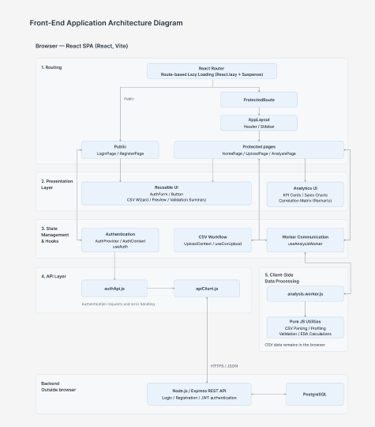
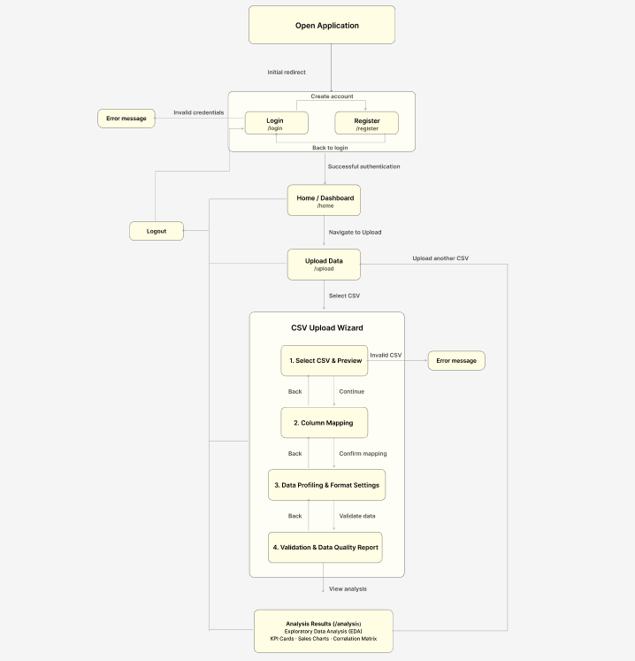

# Front-End Architecture and Development

## 1. Front-End Application Architecture

The front-end of the Predictive Business Analytics Platform is developed as a Single Page Application (SPA) using React and Vite. The application follows a component-based architecture and separates routing, presentation, state management, API communication, and client-side data processing.

The architecture consists of five main parts:

- **Routing and Access Control:** React Router manages navigation between public and protected routes. The application uses `ProtectedRoute` to restrict access to authenticated users and implements route-based lazy loading.
- **Presentation Layer:** The user interface is divided into pages, reusable UI components, and analytics components, including KPI cards, sales charts, and a correlation matrix.The interface also includes sections for sales forecasting and customer segmentation, which are not yet implemented.
- **State Management and Hooks:** React Context and custom hooks manage authentication, the CSV upload workflow, and communication with the Web Worker.
- **API Layer:** Centralized API modules handle HTTP requests to the backend for user registration and login.
- **Client-Side Data Processing:** A Web Worker performs CSV parsing, data profiling, validation, and exploratory data analysis using separate JavaScript utility functions. Sales forecasting and customer segmentation are planned to be implemented using the same Web Worker architecture.

Figure 1 presents the front-end architecture and the connections between its main components.

_Figure 1. Front-end application architecture of the Predictive Business Analytics Platform._

The architecture separates authentication from analytical data processing. Authentication requests are sent to the Node.js/Express backend, which interacts with PostgreSQL. In the current client-side processing mode, uploaded CSV files and calculated analytical results remain in the browser and are not transmitted to the backend.

2. Architecture Approach

2.1 Component-Based Architecture

The front-end application follows a component-based architecture using React. The user interface is divided into pages, layout components, and smaller UI components with clearly defined responsibilities.

Pages such as LoginPage, UploadPage, and AnalysisPage represent the main application views. Shared layout components, including AppLayout, Header, and Sidebar, provide a consistent interface across protected routes. Other components, such as AuthForm, CsvPreview, and KpiCard, encapsulate specific interface elements.

2.2 Routing and Access Control

React Router is used to implement client-side navigation without full-page reloads. The application provides public routes for login and registration and protected routes for the main workspace.

The ProtectedRoute component checks the authentication state before granting access to protected pages. Route-based lazy loading is implemented using React.lazy and Suspense, allowing page components to be loaded only when required.

This reduces the amount of JavaScript needed during the initial application load.

2.3 State Management

The application combines local React state with Context API and custom hooks.

Local state is used for component-specific interactions, such as form inputs and active analysis tabs. Shared state is divided into two main areas:

AuthContext manages authentication information and provides access to login, registration, and logout functionality.

UploadContext provides access to the uploaded CSV data, column mapping, validation results, and the analysis workflow.

Custom hooks, including useAuth, useCsvUpload, and useAnalysisWorker, encapsulate related state management and application logic.

2.4 Separation of Concerns

The application separates the user interface, API communication, state management, and data-processing logic into dedicated modules.

API communication is handled by apiClient.js and authApi.js, while CSV parsing, validation, data preparation, and analytical calculations are implemented as separate JavaScript utility functions in src/utils.

React components are primarily responsible for displaying information and handling user interactions, while hooks coordinate application state and processing operations.

2.5 Client-Side Processing

The application uses a Web Worker to perform computational tasks outside the main browser thread.

Communication with the Worker is managed through the useAnalysisWorker hook, which sends tasks, receives results, handles errors, and supports task cancellation.

The currently implemented Worker operations include CSV parsing, data profiling, validation, and exploratory data analysis. Sales forecasting and customer segmentation are planned to use the same processing architecture.

This approach helps maintain interface responsiveness during data processing and supports the project's planned comparison of client-side and server-side computations.

## 3. API Documentation

The front-end application communicates with the Node.js/Express backend through a REST API. API requests are handled by a centralized client implemented in `apiClient.js`.

The table below presents the implemented authentication endpoints and the planned endpoints for analytical functionality.

| Method | Endpoint             | Description                               | Status      |
| ------ | -------------------- | ----------------------------------------- | ----------- |
| POST   | `/api/auth/register` | Register a new user                       | Implemented |
| POST   | `/api/auth/login`    | Authenticate a user and receive a JWT     | Implemented |
| GET    | `/api/auth/me`       | Retrieve the current authenticated user   | Implemented |
| POST   | `/api/analyses`      | Submit a dataset for server-side analysis | Planned     |
| GET    | `/api/analyses`      | Retrieve analysis history                 | Planned     |
| GET    | `/api/analyses/:id`  | Retrieve saved analysis results           | Planned     |

The paths of the planned endpoints are preliminary and may change during implementation.

Server-side analysis is planned to include exploratory data analysis, sales forecasting, and customer segmentation.

In client-side mode, CSV files are processed locally using a Web Worker and are not transmitted to the backend. Analysis history will be available only for server-side processing.

### API Reference

Detailed documentation for the implemented REST API, including HTTP methods, request and response schemas, examples, and error responses, is provided through Swagger/OpenAPI.

The frontend uses a centralized API client (`apiClient.js`) for HTTP communication, JWT authentication headers, and error handling.

**API Documentation:** https://predictive-business-analytics-backend.onrender.com/api-docs/

## 4. User Flows and Navigation

The application provides public routes for user registration and login, while the main workspace is accessible only to authenticated users.

The main user flow starts with authentication, followed by CSV file upload and a four-step data preparation process: file preview, column mapping, data profiling and format settings, and data validation. After completing these steps, users can proceed to the Analysis page to view exploratory data analysis (EDA) results, including KPI cards, sales charts, and a correlation matrix.

The application also includes an Analysis History page with search, filtering, and sorting functionality, currently demonstrated using sample data.

Users can return to previous steps of the CSV workflow, navigate between application pages, and upload another dataset. The interface also provides error messages for invalid files and unsuccessful authentication.

Figure 2 illustrates the main user navigation and CSV analysis workflow.

_Figure 2. User navigation and CSV analysis workflow._

## 5. Tech Stack Justification

The front-end technology stack was selected based on the requirements for a modular, responsive, and maintainable Single Page Application (SPA) with interactive data visualizations and client-side data processing.

| Technology                           | Justification                                                                                                                                                    |
| ------------------------------------ | ---------------------------------------------------------------------------------------------------------------------------------------------------------------- |
| **React**                            | Provides a component-based approach for building reusable UI elements and managing interactive interfaces.                                                       |
| **Vite**                             | Provides a development server and production build tools, including support for code splitting and lazy loading.                                                 |
| **JavaScript**                       | Allows the same data-processing algorithms to be used in the browser and Node.js, supporting the planned comparison of client-side and server-side computations. |
| **React Router**                     | Enables client-side navigation, public and protected routes, and route-based lazy loading.                                                                       |
| **Context API and Custom Hooks**     | Manage shared application state and encapsulate related logic without introducing an additional state management library such as Redux.                          |
| **Custom CSS**                       | Provides flexibility to implement the application's visual design and responsive layouts without relying on a third-party UI component library.                  |
| **Recharts**                         | Supports interactive data visualizations, including sales charts and correlation-related visualizations.                                                         |
| **Papa Parse**                       | Provides CSV parsing functionality for uploaded datasets.                                                                                                        |
| **Web Workers**                      | Move CSV processing and analytical calculations outside the main browser thread to improve interface responsiveness.                                             |
| **Vitest and React Testing Library** | Support automated unit and integration testing of application logic and React components.                                                                        |

The selected technologies support separation of concerns, code reuse, and independent testing. They also provide a foundation for extending the platform with sales forecasting, customer segmentation, and server-side data processing.
